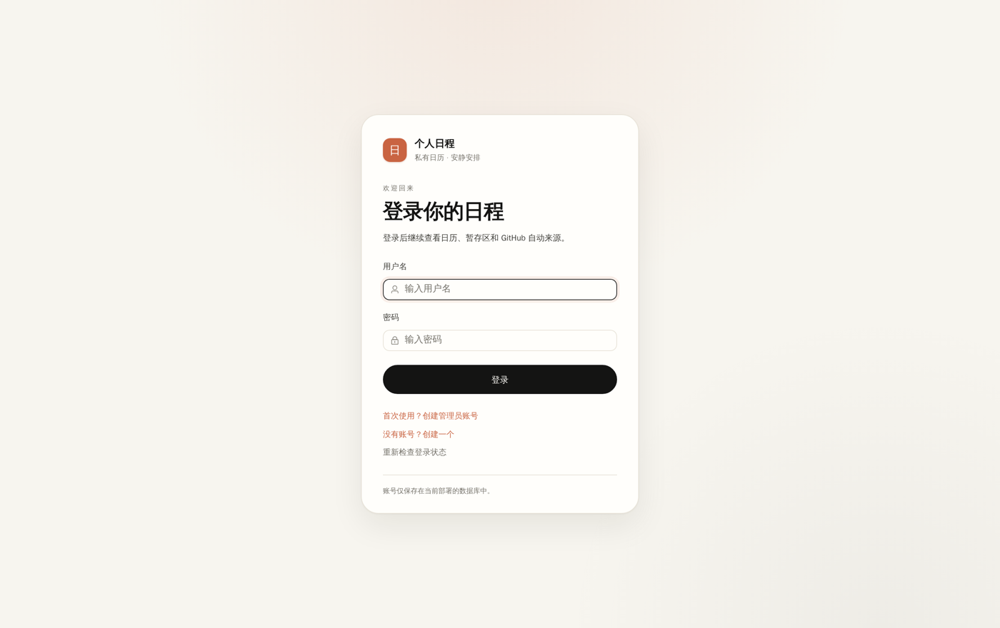
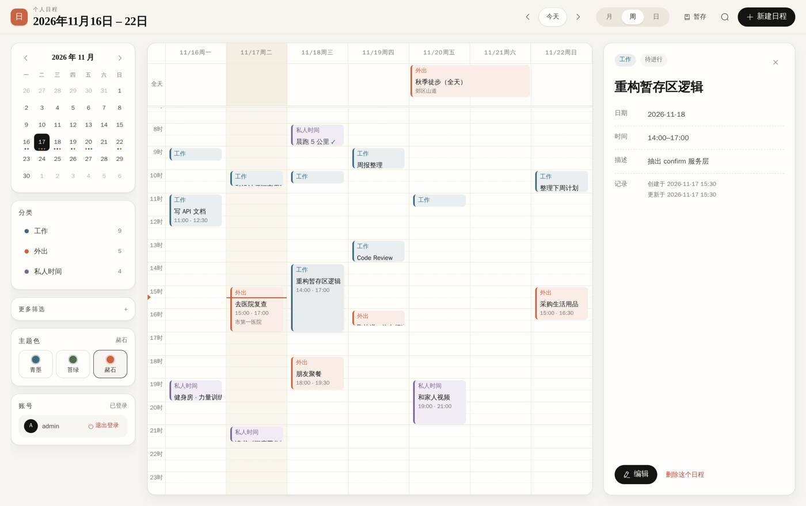
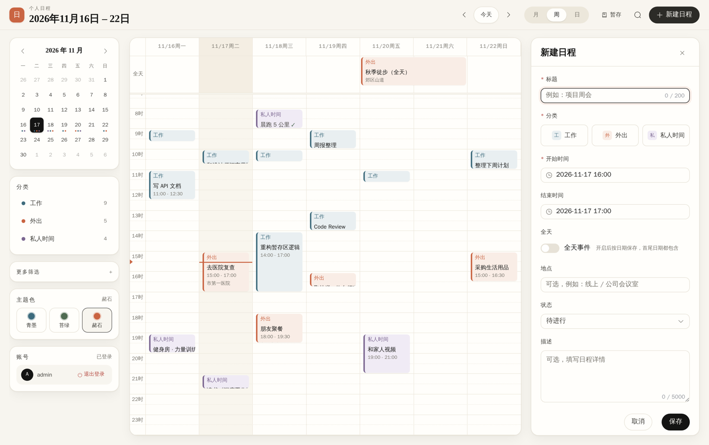
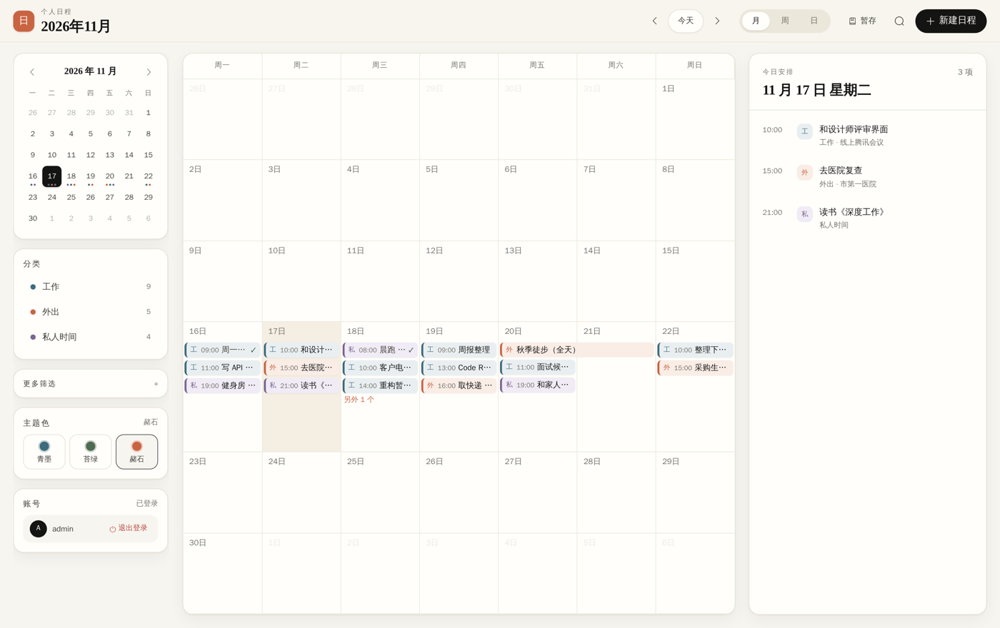
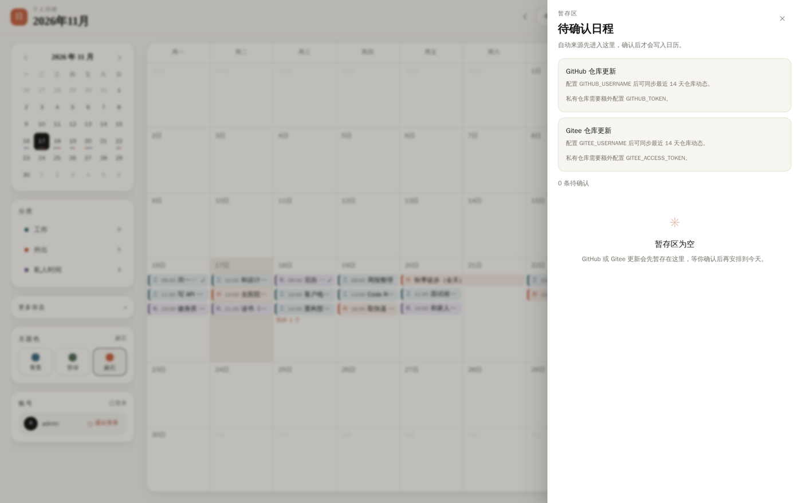
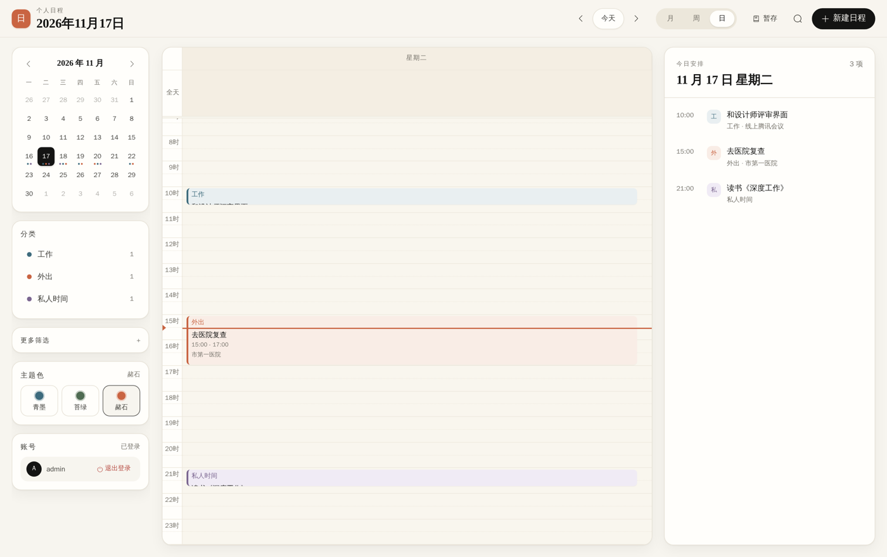
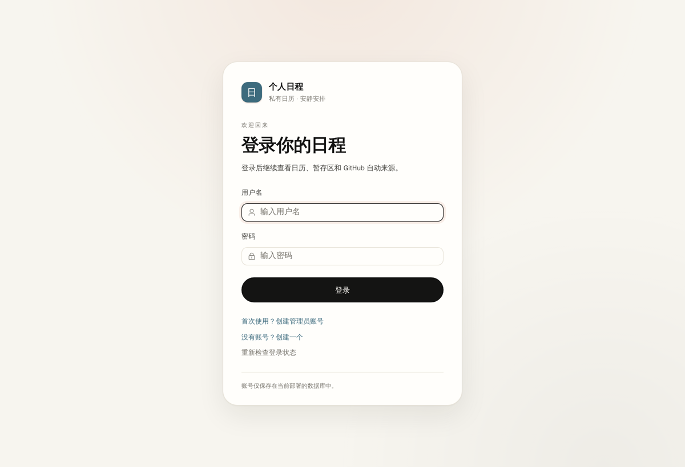
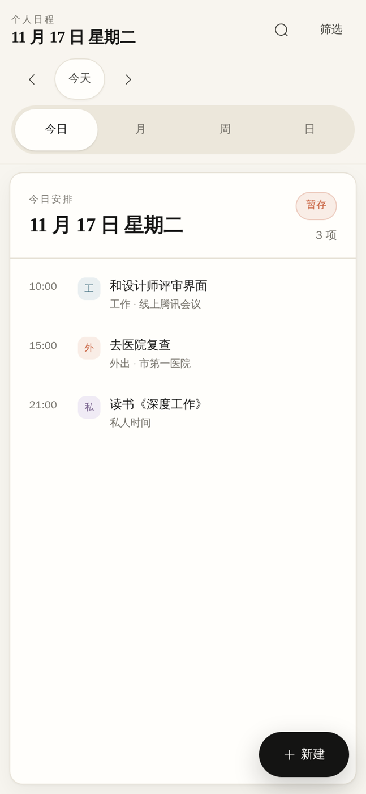
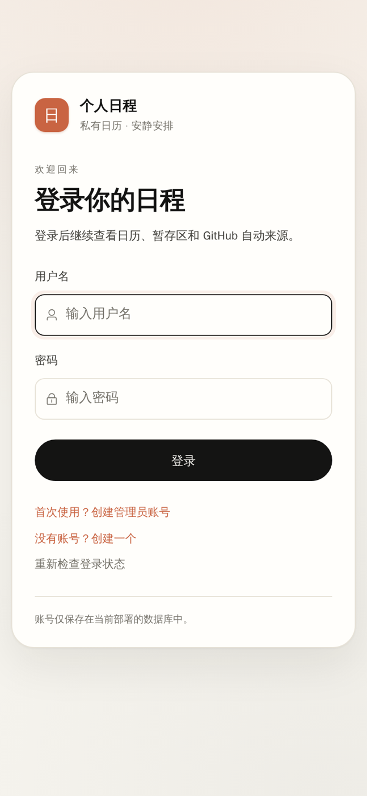

# 个人日程系统 · 项目介绍

> 一个多账号、需要登录的个人日程系统。日程分工作 / 外出 / 私人时间三类，日历是页面主角；支持 GitHub / Gitee 自动来源暂存区、Web 与 QQ 双入口的对话助手。
>
> 仓库：<https://github.com/Ly1to/smart-digital-clone> · 更新日期：2026-11-20
> 技术栈文档见 [../docs/02-tech-stack.md](../docs/02-tech-stack.md)，架构见 [../docs/ARCHITECTURE.md](../docs/ARCHITECTURE.md)

---

## 1. 项目概览

| 项 | 内容 |
| --- | --- |
| 形态 | Web 单页应用 + REST API + SQLite，Docker Compose 一键部署 |
| 定位 | 单人 / 小团队自托管的私有日程工具，重「安静安排」而非协作 |
| 视觉 | 暖米色画布、近黑墨色、陶土红强调、衬线标题，参考 claude.com 的克制暖色体系 |
| 前端 | Vue 3 + TypeScript + Vite + Pinia + Element Plus + Tailwind CSS v4 + FullCalendar 6 |
| 后端 | Python 3.14 + FastAPI + Pydantic 2 + SQLAlchemy 2 + Alembic + SQLite |
| 部署 | Docker Compose + Nginx（静态与 `/api` 反向代理）+ SQLite 命名卷 |
| 规模 | 后端 47 个 Python 文件；前端 20 个单文件组件 + 20 个 TS 模块；测试 91（pytest）+ 70（Vitest）+ e2e 16 个执行项 |

### 1.1 能力状态

| 能力 | 状态 | 说明 |
| --- | --- | --- |
| 日程 CRUD、日 / 周 / 月视图 | 已实现 | 三类固定分类，颜色 + 中文 + 单字标记三重区分 |
| 搜索、筛选、小月历 | 已实现 | 300ms 防抖、按日期分组，分类 / 状态 / 日期范围组合筛选 |
| 多账号登录、注册、数据隔离 | 已实现 | scrypt 哈希 + JWT，所有业务接口按 `user_id` 隔离 |
| 主题系统与响应式界面 | 已实现 | 赭石 / 青墨 / 苔绿，桌面 / 平板 / 移动三档布局 |
| GitHub / Gitee 自动来源 + 暂存区 | 已实现 | 先暂存、再确认，确认后才写入日历 |
| 对话助手（DeepSeek + 只读工具） | 已实现 | HTTP 调试入口，支持查询 / 搜索 / 详情 / 按天汇总 |
| QQ 接入与账号绑定 | 已实现 | OneBot v11 正向 WebSocket（NapCat / Lagrange） |
| 提醒、重复日程、标签、ICS | 未实现 | P1 规划，见 [../docs/ROADMAP.md](../docs/ROADMAP.md) |

---

## 2. 功能详情

### 2.1 日历与日程

- 桌面端默认周视图，可在**日 / 周 / 月**之间切换并前后翻页；点击空白格或用「新建日程」创建，自动带入所在日期与时间
- 点击日程打开详情：分类、状态、日期、时间、地点、描述、创建与更新记录
- 编辑、删除（二次确认）、未保存修改提醒（关闭面板时提示「放弃修改」）
- 全天事件独立开关，跨天与全天日程按首尾日期展示
- 三类日程各有固定色系（工作=雾蓝、外出=陶土红、私人时间=藕紫），不随主题变化

### 2.2 搜索与筛选

- 顶部搜索浮层：`300ms` 防抖、按日期分组结果、点击结果跳转并打开详情
- 左侧小月历、分类计数、状态、日期范围组合筛选，支持「显示全部」一键清除
- 筛选条件进入 Pinia，跨视图保持一致

### 2.3 自动来源与暂存区

```text
GitHub / Gitee 最近 14 天仓库动态
  -> 按仓库聚合为待确认日程
  -> 分配今天 09:00–22:00 内的空闲时段
  -> 暂存区调整 / 逐条插入 / 全部插入 / 丢弃
  -> 确认后才写入 schedules
```

- 重复同步不会产生重复暂存项：`(user_id, source, source_ref)` 唯一约束 + 已确认条目跳过
- 后台按可配置间隔自动同步（默认 360 分钟，0 表示只手动触发）

### 2.4 账号

- 首次部署引导创建管理员，之后可在注册页创建更多账号（`ALLOW_REGISTRATION=false` 可关闭）
- JWT 默认有效期 7 天，保存在浏览器本地；退出只清理 Token
- 每个账号的日程、暂存区、自动来源配置相互隔离

### 2.5 主题与响应式

- 三套强调色（赭石默认 / 青墨 / 苔绿），只改变界面强调色，不改分类色
- 主题写入 `localStorage`，刷新保持
- 桌面 ≥1280px 三栏；平板 768–1279px 收起侧栏、筛选走抽屉；移动 <768px 默认今日议程 + 底部抽屉 + 悬浮新建
- 键盘：`N` 新建、`T` 回到今天、`/` 搜索、`Esc` 关闭

### 2.6 对话助手与 QQ

- `/api/bot/chat` 调试入口 + `/api/bot/status` 配置状态
- DeepSeek（OpenAI 兼容）作为默认 Provider，只读工具：`list_schedules`、`search_schedules`、`get_schedule`
- 会话保留最近 6 轮（可配），工具调用最多 4 轮，单次 LLM 超时 30s
- QQ：私聊、群聊 @ 均可；网页端生成一次性绑定码（默认 10 分钟有效），私聊机器人发送绑定码完成绑定
- 支持用户 / 群白名单与长回复自动分片

---

## 3. 使用方式

### 3.1 本地开发

需要 Python 3.14、uv、Node.js 26、npm 12、make。

```bash
make setup     # 安装后端（uv sync）与前端（npm install）依赖
make migrate   # 初始化数据库（Alembic 迁移到 head）
```

两个终端分别启动：

```bash
# 终端一：后端
cd backend && uv run uvicorn app.main:app --reload --host 127.0.0.1 --port 8000

# 终端二：前端
cd frontend && npm run dev
```

打开 <http://127.0.0.1:5173>。首次进入会引导创建管理员账号；Vite 把 `/api` 代理到 `8000`，本地无需配置 CORS。

- Swagger：<http://127.0.0.1:8000/docs>
- 健康检查：<http://127.0.0.1:8000/api/health>
- 默认数据库：仓库根目录 `data/schedules.db`，可用 `DATABASE_URL` 覆盖

### 3.2 Docker 部署

```bash
cp .env.example .env
# 至少填写 JWT_SECRET（openssl rand -base64 48）
make docker-up
```

打开 <http://127.0.0.1:8080>（端口由 `APP_PORT` 控制）。后端容器启动时自动执行 `alembic upgrade head`，空闲时也可在 `.env` 配置 `AUTH_BOOTSTRAP_USERNAME` / `AUTH_BOOTSTRAP_PASSWORD` 自动创建首个管理员。

```text
浏览器 :8080
  |
  v
web (Nginx)
  |-- /        -> Vue 静态文件（SPA 回退、资源长缓存）
  |-- /api/    -> backend:8000
                    |
                    v
                SQLite /app/data/schedules.db（命名卷）
```

日常运维：`make docker-ps`、`make docker-logs`、`make docker-down`、`make backup`（SQLite 在线备份到 `backups/`）。

### 3.3 上手路径

1. 登录页创建管理员 → 进入周视图
2. 「新建日程」或点击日历空白处 → 填标题、分类、起止时间（可切全天）→ 保存
3. 顶部搜索或 `/` 打开搜索浮层；左侧分类 / 状态 / 日期范围做组合筛选
4. 在 `.env` / `.env.example` 配置 GitHub 或 Gitee 用户名 → 顶部「暂存」查看待确认日程 → 调整后逐条或全部插入
5. 左下「主题色」切换青墨 / 苔绿；设置保存在本地
6. 需要对话助手时配置 `DEEPSEEK_API_KEY`；需要 QQ 时再开 `QQ_BOT_ENABLED` 与 `ONEBOT_WS_URL`（详见 [../docs/06-qq-bot.md](../docs/06-qq-bot.md)）

### 3.4 常用命令

| 命令 | 作用 |
| --- | --- |
| `make test` | 后端 pytest + 前端 Vitest |
| `make check` | Ruff / ESLint / Prettier / TypeScript |
| `make e2e` | Playwright 端到端（自动启动前后端与临时数据库） |
| `make build` | 前端生产构建（含类型检查） |
| `make verify` | `check` + `test` + `build`，提交前一条命令通行 |
| `make backup` | 在线备份 SQLite 数据库 |

---

## 4. 项目亮点

1. **克制而完整的视觉体系**：把设计令牌集中在 `frontend/src/styles/main.css`（Tailwind v4 `@theme`），三套主题只换强调色；衬线标题 + 近黑墨色 + 暖米色画布，让日历本身成为页面主角，而不是被工具栏淹没。
2. **「先暂存、再确认」的自动来源**：GitHub / Gitee 动态不直接落库，而是先聚合成待确认日程，允许人工调整时间后再插入，避免第三方数据污染日历。
3. **真实的空闲排程算法**：在 `09:00–22:00` 窗口内按 5 分钟粒度寻找第一个可用时段，考虑重叠区间合并、跨天与全天占用，并在插入时按顺序滚动分配。
4. **从存储到展示的时区一致性**：数据库一律存 UTC，日边界与排程窗口按 `APP_TIMEZONE` 计算，前端按浏览器本地时区渲染；全天事件按「首尾日期都包含」单独归一化。
5. **可替换的对话助手**：`llm.py` 只定义 Provider 协议，DeepSeek 只是默认实现；`pipeline.py` 负责工具调用循环，`tools.py` 的只读工具与 Provider 解耦，因此换模型、加写操作都不影响上层。
6. **QQ 与 Web 共用一套业务服务**：机器人走的是与 REST 相同的 service 层，权限同样按 `user_id` 隔离，绑定码一次性、带 TTL。
7. **单机低成本、可运维**：Compose 编排两个容器、健康检查、日志轮转、SQLite 命名卷与在线备份脚本，没有为「可能的高并发」提前引入 PostgreSQL / Redis。
8. **测试覆盖到边界而不是只跑通主流程**：时区、全天 / 跨天、幂等同步、无空档、白名单、分片、越权 404 都有对应用例（见第 5 节）。

---

## 5. AI 测试技术落地概述

### 5.1 落地形态

测试体系按「**AI 可读、可生成、可无人值守执行**」设计，形成四层：

| 层 | 工具 | 数量（实测） | AI 参与的落点 |
| --- | --- | --- | --- |
| 后端单元 / 接口 | pytest + pytest-asyncio + HTTPX | **91 passed** | 由业务规则直接映射用例（校验、隔离、幂等、排程、时区） |
| 前端单元 / 组件 | Vitest + Vue Test Utils + jsdom | **70 passed**（9 个文件） | 状态与表单逻辑先测，再改 UI |
| 浏览器端到端 | Playwright（桌面 + 移动两个 project） | 16 个执行项：8 通过 / 8 跳过 | 用例即「可执行的验收清单」，AI 可独立运行并读取失败信息 |
| 静态质量门 | Ruff / ESLint / Prettier / vue-tsc | 全量扫描 | 一条 `make verify` 即可闭环校验 |

### 5.2 四个可复用的测试手法

1. **伪 LLM（Fake Provider）**：LLM 输出不可复现，因此把 Provider 抽象成协议，测试注入脚本化实现，只断言「工具调用是否正确、结果是否落进回复」。
   ```python
   app.dependency_overrides[get_llm_provider] = lambda: fake_provider
   ```
2. **Fake WebSocket**：QQ 侧不启动真实 OneBot 连接，直接构造 OneBot 事件调用 `handle_event`，用 `FakeWebSocket` 记录 `send()` 的 action / params / 分片结果。
3. **依赖覆盖 + 内存 SQLite**：每个用例独立内存库、固定 JWT Secret、清空第三方配置；需要改配置用 `monkeypatch.setattr(settings, ...)`，避免测试之间互相污染。
4. **端到端自举**：Playwright `webServer` 自动拉起后端（临时库 `/tmp/digital-clone-e2e.db`）与 Vite，跑完即弃，既能在本地零配置执行，也能进 CI。

### 5.3 AI 参与的实际流程

```text
docs/ 基线文档（产品范围 / 技术栈 / 视觉规范 / API / 架构）
  -> 作为上下文输入，产出「需求 → 用例」映射
  -> 生成 pytest / Vitest / Playwright 用例
  -> make verify 一键校验（Ruff + ESLint + 类型 + 单测 + 构建）
  -> make e2e 浏览器回归
  -> 失败信息回流，定位到具体层（约定错误 / 组件 / 交互）
```

本次介绍文档所需的界面截图，也是由 AI **直接驱动浏览器**完成的：先起临时数据库与引导管理员，用脚本通过 REST 灌入示例日程，再用 Playwright 以 1512×950 与 390×844 两种视口完成登录、切换视图、打开详情 / 表单 / 搜索 / 暂存区、切换主题，并在关键状态逐个截图——全程不触碰真实 `data/schedules.db`。

### 5.4 现状的不足与下一步

| 不足 | 影响 | 计划 |
| --- | --- | --- |
| 没有 CI 配置（无 `.github/workflows`） | 校验依赖人工执行 `make verify` | 增加 GitHub Actions：check + test + build + e2e |
| 无覆盖率门禁 | 新增代码可能未被覆盖 | 接入 `pytest-cov` / `vitest --coverage`，设阈值 |
| 无真实 QQ 端到端 | 联调风险靠人工验收 | 按 DEPLOYMENT 手工走一遍；后续可用 Mock OneBot 服务容器化 |
| 无视觉回归 | 样式改动靠肉眼 | Playwright `toHaveScreenshot` 基线截图 + 阈值对比 |
| e2e 只覆盖主流程 | 边界交互（拖拽改期等）缺失 | 按 ROADMAP 补关键路径 |

---

## 6. 关键技术

### 6.1 技术栈一览

| 层 | 选型 |
| --- | --- |
| 前端框架 | Vue 3 + TypeScript、Vue Router 4、Pinia |
| 构建 / 样式 | Vite 8、Tailwind CSS v4（`@theme` 令牌）、Element Plus 2 |
| 日历 / 日期 | FullCalendar 6（dayGrid / timeGrid / interaction）、Day.js |
| 请求 | Axios（统一拦截器与错误文案） |
| 后端框架 | FastAPI + Pydantic 2（校验与 OpenAPI）+ Uvicorn |
| 数据 | SQLAlchemy 2 + Alembic + SQLite（单写者，命名卷持久化） |
| 认证 | scrypt 加盐哈希 + JWT（HS256） |
| LLM | DeepSeek（OpenAI 兼容）+ httpx，Provider 协议可替换 |
| 即时通讯 | OneBot v11 正向 WebSocket（NapCat / Lagrange） |
| 质量 | pytest / Vitest / Playwright / Ruff / ESLint / Prettier / vue-tsc |
| 部署 | Docker 多阶段构建、Nginx（SPA 回退 + `/api` 代理 + 安全响应头）、Compose |

### 6.2 时间与时区

- 数据库只存 UTC（`DateTime(timezone=True)` 语义统一在 `core/time.py`）
- 无时区输入按 UTC 解释；`APP_TIMEZONE` 决定「今天 09:00–22:00」这类业务窗口
- 全天事件归一化为「开始日 00:00:00 UTC → 结束日 23:59:59.999999 UTC」，保证首尾日期都显示
- 前端展示统一走浏览器本地时区，避免「后端算出空档、前端显示错位」

### 6.3 认证与数据隔离

- `scrypt`（N=16384 / r=8 / p=1）加盐哈希，存库格式自描述（`scrypt$N$r$p$salt$digest`），便于未来升级参数
- JWT 只携带用户标识，`deps.py` 统一解析出当前用户，所有查询强制带 `user_id`
- 越权访问返回 404 而非 403，避免泄露资源是否存在

### 6.4 数据模型与迁移

`users` · `schedules` · `staged_schedules` · `qq_bindings` 四张表，迁移 5 个版本（`0001`–`0005`）线性演进：

```text
0001 schedules           0003 users（登录）
0002 自动来源 + 暂存区    0004 为日程/暂存区加 user_id
                         0005 QQ 账号绑定
```

应用启动**不建表**，表结构只由 Alembic 管理，避免「本地能跑、部署缺列」。

### 6.5 自动排程算法

```python
find_free_slot(busy, day_start, day_end, duration, granularity_minutes=5)
```

- 先按开始时间排序并合并重叠区间
- 候选起点向上对齐到 5 分钟粒度
- 依次尝试区间间隙，返回第一个能容纳 `duration` 的时段；找不到抛 `NoFreeSlotError`

### 6.6 对话管道

```text
消息 -> 会话历史（进程内，最近 6 轮） -> LLM(带 tools)
      -> 若有 tool_calls：执行只读工具 -> 结果回填 -> 再问 LLM（最多 4 轮）
      -> 组装回复 -> 分片（QQ 默认 1200 字/条）
```

失败路径分别映射为 `BotNotConfiguredError`（503）/ `BotUpstreamError`（502）/ `BotResponseError`，不把上游错误原样抛给用户。

### 6.7 前端渲染与设计令牌

- 设计令牌集中在 `main.css` 的 `@theme` 与 `:root[data-theme=...]`，Element Plus 主色通过 `--el-color-primary: var(--color-focus)` 跟随主题
- 日历事件不用默认渲染，而是 `renderEventContent` 手写 DOM 节点：分类色条 + 分类文字 + 标题 + 时间 + 地点，月视图与时间格分别适配
- 组件分层：`views`（页面）/ `components`（calendar、agenda、filters、schedule、staging、settings、common）/ `stores`（auth、schedule）/ `utils`（日期、表单、事件渲染）

### 6.8 部署与运维

- 后端多阶段镜像，启动脚本内 `alembic upgrade head`，非 root 运行，带健康检查
- 前端 Nginx：`try_files ... /index.html` 做 SPA 回退，`/assets/` 一年长缓存、`index.html` 不缓存，附带 `nosniff` / `SAMEORIGIN` / `Referrer-Policy`
- SQLite 数据落在命名卷，`scripts/backup-db.sh` 用 SQLite 在线备份 API 生成一致性快照

---

## 7. 界面一览

### 7.1 登录页（赭石主题）

暖米色渐变背景 + 白色卡片，衬线大标题，主按钮为实心近黑；下方是「创建管理员账号 / 注册 / 重新检查登录状态」三个轻量入口。



### 7.2 桌面周视图

三栏布局：左侧小月历 / 分类计数 / 更多筛选 / 主题色 / 账号，中间周视图，右侧「今日安排」。当前时间有红色指示线，今日列有暖色底。


### 7.3 日程详情

右侧面板展示分类、状态标签、日期、时间、描述与创建/更新记录，底部是编辑与删除。



### 7.4 新建日程表单

标题（含字数计数）、分类单选、开始/结束时间、全天开关、地点、状态、描述。



### 7.5 搜索浮层

`/` 或顶部搜索打开，输入即搜（300ms 防抖），结果按日期分组并显示时间与分类。


### 7.6 月视图

月视图把事件压成一行「时间 + 标题」，超出部分显示「另外 N 个」，周六日以浅色列区分。



### 7.7 暂存区抽屉

未配置来源时给出配置指引；配置后按「待确认」列出自动来源生成的日程，可调整后插入。



### 7.8 日视图

单日时间轴，事件整行铺满，适合看一天的密度与空档。



### 7.9 青墨主题

切换主题后强调色变为青墨（`#3d6b7d`），分类色保持不变。


### 7.10 青墨主题登录页

强调色贯穿印章、链接与焦点环，主题在登录前后都生效。



### 7.11 移动端今日议程（390×844）

默认进入「今日」，底部胶囊切换今日 / 月 / 周 / 日，悬浮「新建」按钮，日程卡片保留分类标记。



### 7.12 移动端周视图

7 天横向压缩展示，全天事件置顶，当前时间线贯穿整行。


### 7.13 移动端登录页



> 截图由一个 Playwright 脚本生成：临时数据库 + 引导管理员 + 示例日程，1512×950 与 390×844 两种视口，详见第 5.3 节。示例数据仅为演示，不影响真实数据。

---

## 8. 附录

### 8.1 目录结构

```text
digital-clone/
  Makefile                 # setup / migrate / test / check / e2e / verify / docker / backup
  docker-compose.yml       # backend + web 编排
  .env.example             # Compose 环境变量
  scripts/backup-db.sh     # SQLite 在线备份
  backend/
    app/{api,core,db,models,schemas,services,bot}
    alembic/               # 5 个迁移版本
    tests/                 # 91 个 pytest 用例
  frontend/
    src/{api,components,constants,stores,styles,types,utils,views}
    tests/                 # 70 个 Vitest 用例
    e2e/                   # Playwright 用例（桌面 + 移动）
    nginx.conf
  data/                    # 本地 SQLite（不入库）
  docs/                    # 设计基线 + 专题 + 使用指南
  intro/                   # 本介绍文档与截图
```

### 8.2 详细文档索引

| 文档 | 内容 |
| --- | --- |
| [../README.md](../README.md) | 项目说明与快速开始 |
| [../docs/01-product-scope.md](../docs/01-product-scope.md) | 产品范围与边界 |
| [../docs/02-tech-stack.md](../docs/02-tech-stack.md) | 技术选型基线 |
| [../docs/03-frontend-design-requirements.md](../docs/03-frontend-design-requirements.md) | 视觉与交互规范 |
| [../docs/04-auto-schedule-sources.md](../docs/04-auto-schedule-sources.md) | 自动来源与排程 |
| [../docs/05-authentication.md](../docs/05-authentication.md) | 登录与认证 |
| [../docs/06-qq-bot.md](../docs/06-qq-bot.md) | 对话助手与 QQ 接入 |
| [../docs/API.md](../docs/API.md) | 接口参考 |
| [../docs/ARCHITECTURE.md](../docs/ARCHITECTURE.md) | 系统架构与代码地图 |
| [../docs/DEPLOYMENT.md](../docs/DEPLOYMENT.md) | 部署与排查 |
| [../docs/TESTING.md](../docs/TESTING.md) | 测试与质量 |
| [../docs/ROADMAP.md](../docs/ROADMAP.md) | 路线图与已知限制 |
